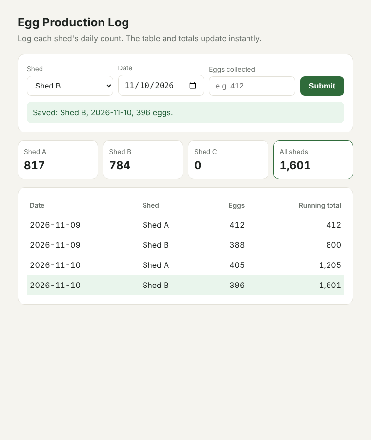

# Egg Production API

A REST API for a poultry farmer in Kiambu with three sheds (A, B and C). Each day he logs how many eggs each shed produced. At the end of the week, one request returns every record with a running total and the total per shed. It replaces sending himself numbers on WhatsApp and adding them up by hand on Saturday.

AI Masterclass 2, Week 4: Day 17 (REST API), Day 18 (browser frontend) and Day 19 (deployment).

## Live Demo

**https://egg-production-api.onrender.com**

- Web form: open the link above
- API: `https://egg-production-api.onrender.com/api/eggs`

It runs on Render's free plan, which goes to sleep after 15 minutes without visitors. The **first visit after a quiet spell can take up to a minute** to load, and after that it's fast.



## Web interface

Open **http://127.0.0.1:5000** with the server running. The farm manager picks the shed, the date and the egg count, then clicks **Submit**:

1. JavaScript `fetch()` sends the record to `POST /api/eggs`.
2. If it's saved, the page calls `GET /api/eggs` and redraws the table and the per-shed totals. **There's no page reload,** and the new row is highlighted.
3. Problems show as a message under the form, never a blank page. That covers an empty count, a non-whole number, a shed already logged for that day, and the server being down.
4. While saving, the button shows **"Saving..."** and is disabled, so a record can't be submitted twice.

It works on a phone screen too, so the manager can log counts from the shed.

## Pricing

- **Build and deploy:** KES 15,000 one-off. That covers building the API, putting it online and showing him how to log eggs from his phone.
- **Monthly:** KES 2,000. That covers hosting, daily backups, fixes and small changes.

## Endpoints

### `POST /api/eggs`: log a day's count for one shed

```json
{ "shed": "A", "date": "2026-11-09", "count": 412 }
```

Returns **201 Created** with the saved record:

```json
{ "id": 1, "shed": "A", "date": "2026-11-09", "count": 412 }
```

| Problem                                           | Status       | Message                                 |
| ------------------------------------------------- | ------------ | --------------------------------------- |
| Missing `shed`, `date` or `count`                 | 400          | Lists the missing field(s)              |
| Shed isn't A, B or C                              | 400          | "Unknown shed 'D'. Use one of: A, B, C" |
| Date not in `YYYY-MM-DD` format, or in the future | 400          | Explains the format                     |
| Count isn't a whole number from 0 to 5,000        | 400          | Explains what's allowed                 |
| That shed already has a record for that date      | 409 Conflict | Prevents counting the same day twice    |

The shed can be sent as `"A"`, `"a"` or `"Shed A"`.

### `GET /api/eggs`: all records with running totals

Records are sorted oldest first. Each one has a `running_total`, and the response ends with totals per shed and for the whole farm.

Optional filters:

- `?shed=A`: one shed only
- `?from=2026-11-09&to=2026-11-15`: one week

```json
{
  "records": [
    {
      "id": 1,
      "shed": "A",
      "date": "2026-11-09",
      "count": 412,
      "running_total": 412
    },
    {
      "id": 2,
      "shed": "B",
      "date": "2026-11-09",
      "count": 388,
      "running_total": 800
    },
    {
      "id": 3,
      "shed": "A",
      "date": "2026-11-10",
      "count": 405,
      "running_total": 1205
    },
    {
      "id": 4,
      "shed": "B",
      "date": "2026-11-10",
      "count": 396,
      "running_total": 1601
    }
  ],
  "totals": {
    "by_shed": { "A": 817, "B": 784, "C": 0 },
    "all_sheds": 1601,
    "records": 4
  }
}
```

## Who could use a tool like this in Kenya, and at what price

The same pattern (log a daily number per unit, then see running totals) fits many small businesses:

| Business                                      | What they'd log                         | Setup      | Monthly   |
| --------------------------------------------- | --------------------------------------- | ---------- | --------- |
| Poultry farms (layers)                        | Eggs per shed per day, mortalities      | KES 15,000 | KES 2,000 |
| Dairy farmers and milk collection centres     | Litres per cow or per farmer per day    | KES 15,000 | KES 2,000 |
| Tea and coffee out-growers and buying centres | Kilos delivered per farmer per day      | KES 20,000 | KES 2,500 |
| Water kiosks and boreholes                    | Jerricans or litres sold per day        | KES 10,000 | KES 1,500 |
| Bakeries and small factories                  | Units produced per line per shift       | KES 15,000 | KES 2,000 |
| Fish ponds and greenhouses                    | Feed used and harvest per pond or house | KES 12,000 | KES 1,500 |

The setup price covers customising the units and fields, hosting it online and training staff. The monthly fee covers hosting, backups and support. For a farm producing about 1,200 eggs a day, catching one shed's drop in production a few days earlier easily pays for the monthly fee.

## Setup and run

```bash
pip install -r requirements.txt
python app.py
```

Open **http://127.0.0.1:5000** for the web form. The API itself is at `http://127.0.0.1:5000/api/eggs`.

## Testing with Postman

1. In Postman, click **Import** and choose `egg-production-api.postman_collection.json`.
2. With the server running, open the collection and click **Send** on each request from top to bottom: 4 valid records, then 5 that should be rejected, then the GET requests.
3. Each request's name shows the status code to expect, e.g. _(expect 201)_.

## Testing with curl

With the server running, open a **second terminal** in this folder and run the test script. It sends 4 valid records across two sheds, then 5 requests that should be rejected, then the GET requests:

```bash
bash test_requests.sh
```

Or send requests yourself:

```bash
curl -X POST http://127.0.0.1:5000/api/eggs \
  -H "Content-Type: application/json" \
  -d '{"shed": "A", "date": "2026-11-09", "count": 412}'

curl http://127.0.0.1:5000/api/eggs
curl "http://127.0.0.1:5000/api/eggs?from=2026-11-09&to=2026-11-15"
```

## CORS

The web page is served by the same Flask app as the API, so the browser treats them as one site and **no CORS is needed**. CORS only matters if a page hosted somewhere else calls this API (e.g. VS Code Live Server on port 5500, or a separate website). To allow that, list those addresses in `.env`:

```
ALLOWED_ORIGINS=http://127.0.0.1:5500
```

Any other website is blocked by the browser. Don't use `CORS(app)` with all origins allowed on a live server.

## Optional API key

To stop anyone with the URL from reading or adding records, create a `.env` file:

```
EGG_API_KEY=a-long-random-string
```

Every API request must then send the header `X-API-Key: a-long-random-string`, or it gets **401 Unauthorized**. The key is meant for scripts and Postman. Leave it unset when using the web page, because putting a secret key in browser JavaScript would expose it to anyone who opens the page. A real deployment would use a login instead. To run the test script with a key:

```bash
API_KEY=a-long-random-string bash test_requests.sh
```

## Deployment (Render)

The app is deployed on [Render](https://render.com) as a free Web Service connected to this GitHub repo. **Every push to `main` re-deploys automatically.**

| Setting       | Value                                      |
| ------------- | ------------------------------------------ |
| Runtime       | Python 3                                   |
| Build command | `pip install -r requirements.txt`          |
| Start command | `gunicorn app:app --workers 1 --threads 4` |
| Instance type | Free                                       |

Notes on the production setup:

- **gunicorn** is the production web server. `python app.py` uses Flask's development server, which isn't safe for live use. gunicorn reads the `PORT` that Render provides automatically.
- **`--workers 1`** matters because records are kept in memory. With several workers, each would have its own separate list, and a record saved by one worker wouldn't show up in another's GET. `--threads 4` still lets it handle several visitors at once.
- **Farm time, not server time.** Render's servers run on UTC, three hours behind Kenya. The app works out "today" in Kenyan time (`FARM_UTC_OFFSET_HOURS`, default 3), so the manager can log today's count at 1 AM without it being rejected as a future date.
- **Environment variables** are set in Render's **Environment** tab, never in code. This app needs none to run. `EGG_API_KEY` and `ALLOWED_ORIGINS` are optional (see below), and secrets must never be committed to GitHub.

gunicorn doesn't run on Windows. On your own computer, keep using `python app.py`.

## Limitations of this version

- **Data is held in memory,** so it's lost whenever the server restarts. On Render's free plan that happens on every deploy and whenever the app goes to sleep. That's fine for a demo. A paying farmer needs a real database, such as Render's PostgreSQL or a hosted SQLite service, so records survive restarts.
- **The live demo has no login,** so anyone with the link can add records. A real deployment needs user accounts.
- Records can't be edited or deleted yet. A `PUT /api/eggs/<id>` endpoint would be the next step for correcting mistakes.
- IDs come from a counter, not `len(records) + 1`, so they stay unique even after deletes are added.
